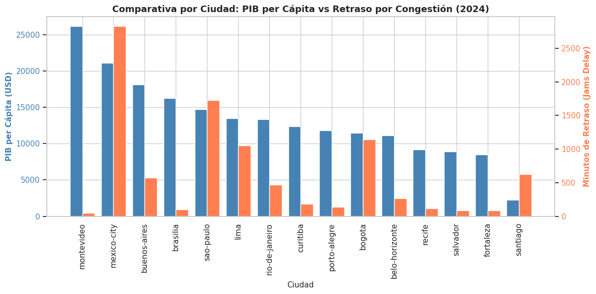
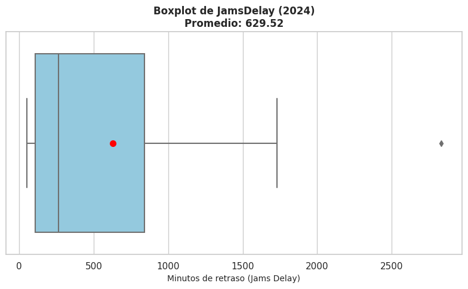
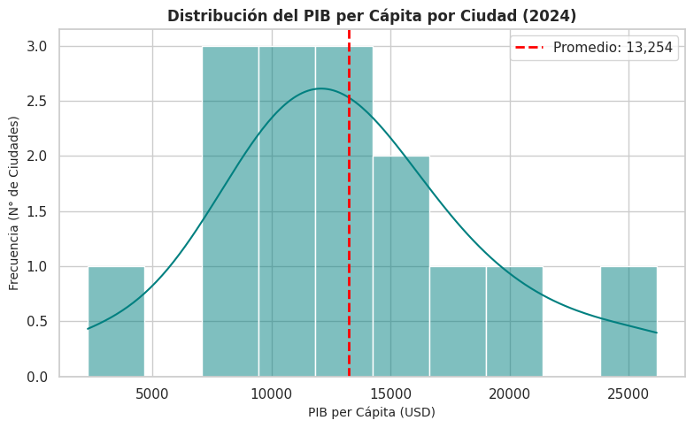

# Urban Mobility and Economy in Latin America

**TripleTen Data Analyst Bootcamp project (2026) | Python · pandas · Seaborn**

Does a higher income per person mean less traffic? This project combines real traffic data from the **TomTom Traffic Index** with economic indicators from **OECD Cities** to compare 15 Latin American cities in 2024 and identify where investment in transport infrastructure is most needed.

## 🎯 Business question

Is there a relationship between urban congestion and economic productivity, and which city should be prioritized for transport infrastructure investment?

## 🗂️ Data

| Dataset | Content | Size |
| --- | --- | --- |
| TomTom Traffic Index | Live traffic records by city: congestion delay, traffic index, jam length and count, travel times | 1,004,464 rows |
| OECD Cities | Yearly economic indicators by city: GDP per capita, unemployment, PM2.5 and population | 30 rows |

## 🛠️ Process

1. **Exploration:** reviewed structure, data types and missing values in both datasets.
2. **Cleaning:**
   - Renamed all columns to `snake_case`.
   - Converted two date columns from text to `datetime`, using `errors='coerce'` to handle invalid values safely.
   - Cleaned numeric columns stored as text in European format (for example, `15.782,00` and `6.2%`): removed thousands separators and percent signs, replaced decimal commas and converted them to `float`.
   - Created a total population column from population in millions.
3. **Filtering and aggregation:** extracted the year from the timestamps, kept 2024 records and calculated yearly averages of seven traffic metrics per city with `groupby`.
4. **Merge:** combined traffic and economic data with an inner join on `city` and `year`, keeping the 15 cities present in both datasets.
5. **Visualization:** boxplot of congestion delay, histogram of GDP per capita and a dual-axis bar chart comparing both variables by city.
6. **Export:** saved the clean, merged dataset as a CSV file for further analysis.

## 📊 Visualizations

  
  

## 💡 Key findings

1. **No direct relationship between income and congestion.** High-income cities such as Montevideo (USD 26,176) and Brasília (USD 16,251) have minimal delays (50.2 and 101.6 minutes), while Mexico City is the most extreme case with 2,833.1 minutes of delay despite a high GDP per capita (USD 21,111).
2. **City scale matters more than income.** The largest metropolitan areas, such as São Paulo (1,729.2 minutes) and Mexico City, concentrate the most severe congestion, which points to population density, urban design and public transport capacity as the main drivers.
3. **Bogotá is the priority city for investment.** Compared with Lima and Buenos Aires, Bogotá combines the most severe congestion (1,141.6 minutes of delay, a traffic index of 37.6 and 140.9 km of average jams) with the lowest GDP per capita (USD 11,442) and 10.0 % unemployment.

## ✅ Recommendation

Focus investment in Bogotá on mass transit infrastructure, such as metro and commuter rail lines. As a next step, a multivariable model including road density and public transport coverage would help explain congestion beyond income.

## ⚠️ Limitations

- Averaging a full year of records smooths out peak-hour congestion.
- With 15 cities, the sample is too small to measure correlation with statistical confidence.
- Santiago's GDP per capita in the source data is unusually low (about USD 2,200) and should be verified before drawing conclusions about that city.

## 📁 Files

| File | Description |
| --- | --- |
| `latam_mobility_economy_analysis.ipynb` | Full analysis: cleaning, aggregation, merge, charts and executive summary (in Spanish) |
| `images/` | Charts used in this README |

The raw datasets were provided by the TripleTen platform and are not included in this repository.

## 🧰 Skills demonstrated

Python · pandas (cleaning, `groupby`, `merge`) · data type conversion · datetime handling · Seaborn and Matplotlib · exploratory data analysis · data storytelling
